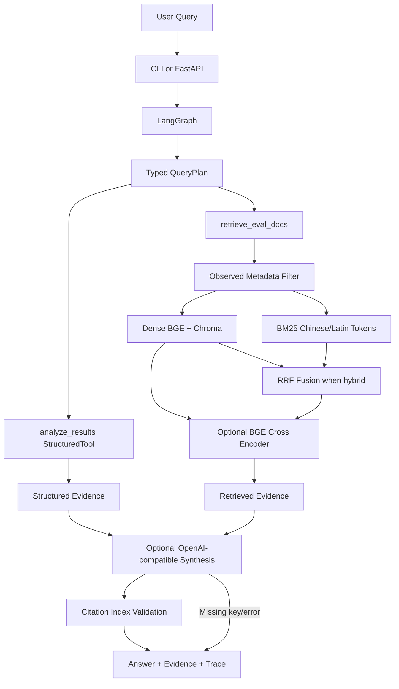

# Evaluation-aware RAG Agent

基于已有「200 个角色 × 4 个图像生成模型」评测资料的本地问答与数据分析应用。它检索工作簿中的 Tier 判读规则和角色原子特征，或调用确定性 CSV 工具汇总错误、Pattern、准确率；可选地用 OpenAI-compatible API 将证据整理成自然语言。原始评测数据只读。

## 1. Project Overview

项目用于快速查询评测规则和核对已有统计结果。默认本地运行，LLM Provider 未配置或调用失败时使用确定性回答。

## 2. Problem

规则分散在 Excel/Markdown，模型错误和准确率结果分散在 CSV。直接搜索不利于按 Tier、角色、模型和错误类型定位；手工汇总又容易误读已人工核定的数据。本项目把文档证据检索与结构化计算分开处理。

## 3. Architecture



当前默认使用 dense 检索；`hybrid`、reranker 均可通过参数启用。QueryPlan 由本地规则将多子句拆成检索与分析任务，不是 LLM 自主规划。

## 4. Data

应用读取项目 `data/` 目录中的评测文件：

- `200角色看图打分工作簿.xlsx`：Tier 规则、操作规则、角色设定、原子特征与判错红线。
- `error_analysis_per_image.csv`：逐图人工错误判定与 Primary Pattern。
- `error_pattern_summary.csv`：模型/Tier/错误类型汇总。
- `qwen_doubao_task_accuracy.csv`、`task_model_accuracy_4x4.csv`：Task/Tier 准确率数据。
- `error_analysis_summary.md`：已有错误分析总结。

文档 chunk metadata 只从源字段构造，包括可用时的 `source`、`document_type`、`character`、`model`、`tier`、`error_type`、`task`、`category` 和 `index`。不适用的字段不写入 metadata。

## 5. Retrieval Pipeline

1. 用 `openpyxl`、CSV 和 Markdown 读取真实项目文件，并转换成 LangChain `Document`。
2. 用 `RecursiveCharacterTextSplitter` 切块，以本地 `BAAI/bge-small-zh-v1.5` 生成向量并保存在 Chroma。
3. 解析查询中的已知模型、角色、Tier、错误类型并构造 metadata filter。
4. `dense` 使用 Chroma cosine similarity；`hybrid` 将 dense 排名与中文/拉丁词项 BM25 结果用 Reciprocal Rank Fusion 合并。
5. 可选 `BAAI/bge-reranker-base` cross encoder 对初始候选重排。

数据内容、metadata、embedding 模型、chunk size 和 overlap 共同决定持久化向量版本；请求级 `index_version` 还包含 retrieval mode 与 reranker 配置。检索缓存键包含数据版本、查询和检索配置，数据变化会失效。

## 6. Agent Workflow

LangGraph 先生成 Pydantic `QueryPlan`，再调用一个或多个注册工具：

- `retrieve_eval_docs(query)`：Tier 规则、角色原子特征、错误案例和 Pattern 证据。
- `analyze_results(query)`：从真实 CSV 做错误数量、Tier 分布、错误类型、准确率和模型对比。

结构化工具负责数字计算，Retriever 负责提供文本证据。系统把来源、metadata、分数和工具轨迹放入响应。若检索无结果或请求了数据集中不存在的模型，会返回 evidence不足提示。

## 7. Structured Analysis and Answer Synthesis

结构化统计不交给 LLM 计算。LLM 仅在 `.env` 配置完整时接收用户问题和已检索/已计算证据；系统要求回答带 `[n]` 引用，并校验引用编号范围。缺少 Key、超时、异常或无效引用时回退到 deterministic synthesis。Provider 使用 Python 标准库调用 OpenAI-compatible Chat Completions 接口。

本地环境未提供 API Key，因此回归验证覆盖了缺 Key、模拟超时、无效引用和 fallback；真实云端 Provider 请求尚未执行。

## 8. Evaluation

- `eval_questions.json`：原 20 题 regression smoke set，运行 `python evaluate.py`。
- `benchmark_questions.json`：由 `build_benchmark.py` 从当前数据生成并冻结 80 题，维度为 Retrieval 20、Structured 20、Hybrid 20、Multi-hop 10、Robustness 10。
- `evaluate_benchmark.py` 对比 Dense、Dense+reranker、Hybrid、Hybrid+reranker，记录 Recall@5、Precision@5、MRR、nDCG@5、Hit Rate、Route Accuracy、Tool Trace Accuracy、Field Accuracy、Task Success 和 latency。
- 逐题及汇总结果分别写入 `benchmark_results.json`、`ablation_results.csv`、`BENCHMARK.md`。

最近一次完整 80 题 ablation 的结果见 [`BENCHMARK.md`](BENCHMARK.md)、[`benchmark_results.json`](benchmark_results.json) 和 [`ablation_results.csv`](ablation_results.csv)。这些是固定项目 benchmark 的自动字段与 metadata 匹配结果，不代表通用 RAG 能力。reranker 在该集合上提升了 MRR/nDCG，但增加了本机 CPU 延迟；Hybrid 本次 MRR/nDCG 低于 Dense，因此默认采用 Dense。`Evidence Coverage` 和语义 `Groundedness` 不做自动百分比评分；云端 LLM 未实测。

核心实现按职责拆分为 `agent.py`（LangGraph/CLI）、`data_store.py`（源数据/Chroma）、`retrieval.py`（dense/BM25/RRF/rerank）和 `analysis_tools.py`（确定性 CSV 统计）。

## 9. API

运行服务：

```powershell
uvicorn api:app --host 127.0.0.1 --port 8000
```

- `GET /health`：服务、Chroma、embedding 缓存和输入文件状态。
- `GET /stats`：当前文档数、chunk 数、索引版本与 embedding 模型。
- `POST /ask`：Pydantic 校验的查询接口；可传 `top_k`、`chunk_size`、`retrieval_mode`、`use_reranker`。响应含 answer、route、tools、evidence、timings 和 index version。

请求事件以 JSONL 写入 `logs/requests.jsonl`；不记录 API Key。服务示例绑定回环地址且未实现鉴权，不应直接暴露到公网。

## 10. Testing

```powershell
python -m pytest -q
python -m pip check
```

测试覆盖路由/QueryPlan、metadata filter、BM25/RRF、真实 Chroma 检索与复开、缓存版本、工具执行、FastAPI 请求/响应、错误输入、模拟损坏 CSV，以及 LLM 缺 Key/超时/引用回退。完整 reranker ablation 也实际运行过。

## 11. Setup

```powershell
git clone https://github.com/curry24x/evaluation-rag-agent.git
cd evaluation-rag-agent
python -m venv .venv
.\.venv\Scripts\Activate.ps1
python -m pip install -r requirements.txt
Copy-Item .env.example .env
python agent.py
```

首次运行会下载并缓存 BGE embedding；若启用 reranker，还会下载 cross encoder。LLM 默认不需要 Key；配置 `.env` 的 `LLM_PROVIDER`、`LLM_BASE_URL`、`LLM_API_KEY`、`LLM_MODEL` 才会启用生成。

## 12. Example Queries

- `Tier 3 的判错红线是什么？`
- `马格纳的核对特征有哪些？`
- `Doubao 在 Tier 4 的错误数量和主要错误类型是什么？`
- `比较 Qwen 与 Doubao 的 Tier 2 错误数，并解释 Tier 2 的判定规则。`

## 13. Current Limitations

- Query planning 是确定性的子句切分与规则分类，面对隐含指代或复杂中文句式仍可能需要改写查询。
- CSV analysis 覆盖当前已知指标和模型；不支持任意自然语言生成新的统计逻辑。
- 80 题 ground truth 依据当前项目数据与 metadata 构造，规模有限，不能替代独立人工标注或外部 benchmark。
- 当前无可用 LLM API Key，真实远端生成、citation correctness 与 groundedness 尚无实测结果。
- BGE reranker 文件较大，CPU 冷启动明显；当前适合作为可选重排实验，不是默认路径。
- API 无认证，仅适合本机或受控网络环境。
